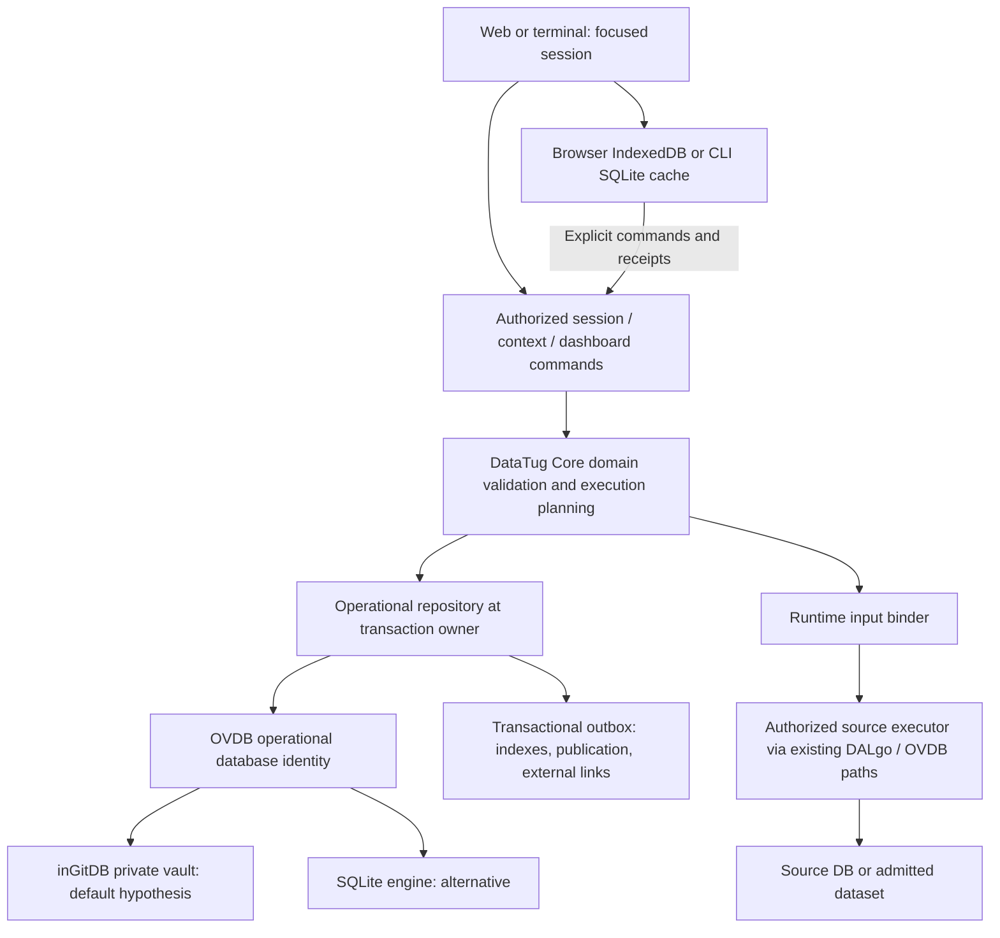

# Session and Context Bag operational architecture

2026-10-13 · Owner approved M0–M3 implementation on 2026-10-13 15:46 UTC; storage profile remains an M0 decision

## Architecture decision

Use **one logical OVDB operational database** for sessions and their Context Bags,
with logical collections for revisions, messages, annotations, audit and evidence
references. Reuse DataTug's domain command boundaries and Detective repository
semantics. OVDB owns database/storage access; DALgo supplies adapter contracts.

Evaluate **inGitDB as the default engine**, **SQLite as an OVDB engine**, and **SQLite
as a cache/proxy of remote OVDB**. These reflect the owner's current ideas, not a
mandate to implement three engines now. Choose after a small capability/latency spike.
Keep private operational data in its own vault, separate from Git-backed project
definitions. Git is neither an authorization model nor a complete sync protocol.



A source database being queried is distinct from the operational database storing
the session. A cloud session may query a reachable local source through an admitted
agent; a local session may query a remote source. Neither arrangement makes the
source available offline.

## Existing seams and the important gap

`datatug-core/pkg/detective/repository.go` already requires atomic resource changes,
optimistic versions, operation receipts and audit. Preserve that contract pattern.
The CLI owns local transport/execution; `datatug/backend` owns hosted application
services, composed by Sneat server routes. Do not bypass those authorization/mutation
boundaries with browser writes to protected operational collections.

The inspected DALgo→OVDB HTTP adapters do separate reads, buffer writes, then POST
`/batch`. The Go adapter rejects update preconditions. Consequently a remote Get
followed by batch is **not** a safe compare-and-write implementation for the domain.

Recommended implementation choice for review: a DataTug command service at the OVDB
engine transaction owner, reusing domain handlers and authorization. An alternative
is an additive OVDB conditional-batch capability with expected record versions,
operation digest and receipt committed together. Either must pass the same race and
crash tests. Never claim that changing an injected DALgo provider supplies these
guarantees automatically. No generic DALgo API change is assumed.

Detective WIP file/JSONL and cloud transaction adapters remain their current owners'
work. This proposal does not rewrite them. Introduce session/bag repository contracts
and an explicit Case evidence bridge. A Case retains selected pinned context/evidence
from sessions; it is not a second editable head of the same bag. Use an outbox when a
Case link and session mutation cross store boundaries; never claim a cross-store ACID
transaction. Sessions must remain usable if a linked Case is unavailable.

### Detective input evidence and cross-store linking

Follow-up inspection of fetched Core main `f54cb46430d61dd26ebb5a35d93f623e1942b932`
confirms `CheckRun.InputNames` deliberately excludes values; operation receipts and
audit are also metadata-only. A Case's current context cannot reconstruct a past run.
Preserve this boundary: a proposed private `RunInputSnapshot` in session OVDB stores
the exact resolved parameter values or authorized immutable collection references,
bag/entry revisions, binding decisions, environment/identity domain and definition
revision. Its read permission and retention are separate from the run summary.
An opaque snapshot reference is not a capability to read its contents.

Before dispatching a context-backed Check, durably create that snapshot and a pending
dispatch record under the authenticated operation identity. Use the same identity on
retry; changed inputs require a new attempt. The adapter must support authoritative
lookup/reconciliation of an accepted request before this path is enabled. An uncertain
dispatch must not be repeated with a fresh identity. For a Case-bound Check, declare
the Case at dispatch and preserve Detective's native atomic run/Case-link finalization;
the session outbox must not replace that transaction. Core's `AttachRun` requires the
run's Case identity to match. A session outbox handles only the additional cross-store
input-evidence handoff and backlink. If that handoff fails after the run is saved, show
**Run saved; input evidence link pending**. Retry that handoff without rerunning the
Check, reauthorize both resources, and persist its receipt. Permission loss becomes a
visible blocked link, not an unbounded retry or false linked state. Confirmed Case-run
linkage uses the authoritative record, not the bounded `Case.RunRefs` projection.
Attaching a previously unbound run to a Case requires an explicitly supported,
authorized additive action; current `AttachRun` cannot be assumed to provide it.

There is no cross-store transaction: crash recovery can leave a pending snapshot with
no confirmed run or a completed run awaiting input-evidence linkage. Reconcile by
operation identity before collecting either record. Session deletion must not silently discard selected
Case evidence; keep a policy-authorized retention reference or show explicit redaction
if erasure policy wins. Preserve a safe run summary if the input snapshot becomes
unavailable. Pinned inputs explain what was executed; they do not promise identical
results when live source data changes.

Core main now also contains `detectiveai` reviewed proposals and `detectiveknowledge`
handoffs. Reuse their typed extraction/provenance and authorization principles in M4,
but `PrepareContextCaseEdit` targets a Case: applying reviewed values to a bag needs an
explicit bag command with expected bag revision and environment checks. Do not send a
fake Case edit or infer session authority from the AI proposal's project scope.
`detectiveai.Source.Text` is sent to the provider and cited quote spans may persist in
private proposals. Therefore Context Bag source-retention choices must cover quotes as
well as full source text, and provider disclosure must be explained separately from
local retention. Do not alter a digest-bound proposal after review; an adapter must enforce
the selected retention policy when preparing it or disable that incompatible route.
No-retention intake may use transient/local parsing until a compatible proposal path
exists. The knowledge handoff is a review artifact, never proof of registry publication.

## Candidate storage profiles

| Profile | Authority | Works offline | Advantages | Gaps / costs |
|---|---|---|---|---|
| Local OVDB + inGitDB | Private local vault | Context, history and local source reads | Reviewable records; Git commit provenance; user ownership | Crash journal proof; writer serialization; scan queries; Git growth and erasure |
| Hosted OVDB + inGitDB | Hosted private vault / Git-backed store | Only explicit cached copies | Browser-only and cross-device access without user CLI | Conditional commands, network latency, private hosting/admission, Git retention |
| OVDB + SQLite engine | Local or hosted OVDB DB | Local profile only without network | Transactions, indexes, compact mutable records | Explicit revision/export design; less directly reviewable files |
| SQLite proxy to remote OVDB | Remote OVDB; SQLite is derived cache | Cached reads and explicit local draft branches | Fast indexed history and CLI offline access | Cache watermark, invalidation, permission policy; writable replay is additional work |
| Browser IndexedDB cache | Named OVDB authority, plus explicitly local drafts | Cached session/history; local edits if offered | Existing DataTug/DALgo foundation | Quota/eviction; no inspected embedded browser OVDB+inGitDB runtime |

**First delivery recommendation:** support one authoritative store per session, local
and hosted deployment profiles of the selected OVDB engine. Local engine sessions can
work offline. Hosted browser clients initially cache authorized history and allow an
explicit **Continue as offline copy** if editing while disconnected is required. The
copy is a durable **local draft package**, not an authoritative OVDB session: it has
a draft ID, origin database/session/revision, pinned local inputs and no authoritative
Check/audit receipt. Reconnection offers idempotent import as a new session, with a
server-issued ID and atomic head/receipt creation after payload staging. Same import
operation returns the same session; failure preserves the package for retry/export.
There is no silent merging. Browser offline editing therefore need not become
multi-writer sync. A cloud-only session with no downloaded state is unavailable offline.

Cache-proxy MVP means read-through, revision-keyed cache; it does not quietly acquire
write authority. If queued same-session edits are later added, commands carry base
versions and reconnection exposes conflicts. Never use last-writer-wins for membership
classification or evidence. Authenticated cached data on a disconnected device cannot
be instantly revoked remotely: use explicit offline grants/expiry policy and display
the last authorization time; sensitive projects may forbid offline copies.

The browser has no demonstrated embedded OVDB/inGitDB write engine. Its IndexedDB
working copy is a named application cache/import boundary, not a claim that raw
IndexedDB is already an OVDB engine. A native browser engine would be a separate spike.

## Logical records and identity

All IDs are opaque path-safe identifiers, with schema version and explicit database
identity. Semantic labels/aliases are not identifiers. Existing slug IDs remain valid.
Do not change Detective resource-ID policy as a side effect of session work.

| Collection | Key data | Required lookup / retention |
|---|---|---|
| sessions | scope, kind, title, state, version, defaultBagId, contextSetId, parentRef, Case/incident refs | scope+state+updatedAt+id; paged |
| bags | sessionId, title, immutable environment/identity domain, version | sessionId; default one |
| entries | sessionId, bagId, semantic subject, alias, currentRevision, version | sessionId; alias unique within bag |
| entryRevisions | parent revision, typed value envelope, payloadRef, count, digest, provenance | immutable ID; retained by references |
| payloadChunks | payloadId, ordinal, typed values, byte length, digest | direct ID; immutable |
| contextSets | immutable enabled gate + scopeKey to manifest refs | session latest contextSetId; historical pinned ID |
| appliedContexts | sessionId, bagId, full pinned scope, enabled, selected revision refs, combination, clock anchor | immutable ID; session latest pointer |
| drafts | sessionId + device/profile, selection, composer, open tabs | private recoverable device state |
| messages / executionRefs | sessionId, pinned input manifest, query revision, result refs | session+sequence, never unbounded ID arrays |
| dashboardRuns / widgetRuns | dashboard revision, shared input manifest, per-widget receipt | run ID + widget ID; consistent input lineage |
| annotations / tags | structured target, origin refs, body ref, normalized tag variants | direct entity key and snapshot target |
| operationReceipts | actor+scope+opId, request digest, result refs, commit state | exact retry lookup |
| auditEvents | action, actor, clock, subject refs, safe counts, opId | bounded session/activity pages |
| outbox / publication | intended external effect, idempotency key, progress/error | retry queue with backoff |
| derivedIndexes | key→snapshot/note refs, revision watermark | rebuildable; never evidence authority |

Scope includes principal/access context, project, environment and **identity domain**.
Session project/database access scope is immutable initially; changing it branches
after review. Bags carry immutable environment/identity scope within that project. Every
applied/message/dashboard input manifest also pins database, project, environment,
identity domain, source mappings and semantic revisions for independent historical reads.
Order 123 in two tenants is not the same entity. Semantic entity identity alone is
insufficient for historic annotations. An explicitly approved source mapping can
establish that two representations address the same identity domain; never infer it.
Do not persist request-only `securityContextId` as a replacement for authorization.

Example storage envelopes (illustrative proposed JSON, not an existing API/schema):

```json
{
  "schemaVersion": 1,
  "id": "s_demo_01",
  "databaseId": "ovdb_ops_01",
  "scope": {"projectId":"shop"},
  "kind": "investigation",
  "state": "stopped",
  "version": 9,
  "defaultBagId": "b_01",
  "contextSetId": "cs_04"
}
```

```json
{
  "schemaVersion": 1,
  "id": "er_07",
  "entryId": "e_orders",
  "bagId": "b_01",
  "scope": {"environmentId":"prod", "identityDomain":"tenant-acme-orders"},
  "parentRevisionId": "er_06",
  "semanticSubject": {"graphResource":"github.com/meaninggraph/core/commerce", "conceptId":"order", "graphRevision":"pinned-commit", "fieldMappingRef":"mapping-order-id-r3"},
  "value": {"kind":"set", "elementType":"entity-key", "payloadRef":"p_5300", "count":5300},
  "keySchema": {"modelRef":"shop-model", "modelRevision":"pinned-commit", "record":"Order", "fields":["TenantID","OrderID"]},
  "provenance": {"kind":"manual-paste", "sourceRetained":false}
}
```

```json
{
  "payloadId":"p_5300", "ordinal":0,
  "values":[
    {"components":[{"field":"TenantID","value":{"type":"string","value":"acme"}},{"field":"OrderID","value":{"type":"integer","value":"123"}}]}
  ]
}
```

Reuse canonical DataTug lossless scalar encoding, particularly integers/decimals stored
as strings. Canonical tuple encoding includes schema field IDs/order, type and exact
value; never concatenate `tenant + ':' + order`. Content digest supports deduplication
within authorized scope, not identity or access. Avoid cross-tenant deduplication leaks.
`scalar|set|list|range|predicate|record-set` envelopes are versioned; unknown kinds are
preserved read-only with an unsupported message. Composite representation is included
now even if its editor arrives later.

MeaningGraph supplies meaning; ModelSpec supplies record/field/key/reference shape;
OVDB locates and controls data access. Current ModelSpec uses record/field vocabulary;
legacy pins remain readable. Store format and revision for MeaningGraph and ModelSpec,
not a guessed permanent URL syntax or assumption that draft readers are released.

## Physical inGitDB layout and indexes

Candidate collection layout: `sessions/$records/<id>.json`,
`entries/$records/<id>.json`, `entry-revisions/$records/<id>.json`,
`payload-chunks/$records/<payload>-<ordinal>.json`, and equivalent receipt/audit records.
Confirm the selected inGitDB definition's record format before implementation; this is
a layout proposal, not a tested manifest. Partition append-heavy collections by bounded
time/hash prefixes when necessary. Do not create 5,300 tiny member files per cohort.

Chunking candidate: up to 512 typed keys **and** 64 KiB per chunk, whichever first.
5,300 small numeric IDs require about 11 chunks; composite/string keys may need more.
Stage immutable chunks, validate total count/digest, then atomically publish their
manifest and entry head with the receipt. Unreferenced staged chunks are collected after
a grace period. Each semantic mutation yields one operation revision, not one Git commit
per keypress. Draft typing stays local; explicit Save/Apply/Send are durable boundaries.

An application revision is not a Git SHA: one commit can contain several related
records, and another engine may not use Git. Keep application IDs and committed-store
revision separately. Distinguish locally committed, remote-published and uncertain;
a failed push after successful commit is publication pending, not a rollback claim.

Current inspected inGitDB and browser DALgo collection queries scan records. For entity
history use exact-key direct lookup or a rebuildable SQLite index keyed by
`(scope, semanticEntity, canonicalKeyHash, snapshotId)`, plus collision-checked canonical
key. Index from committed revision manifests and retain a watermark. Missing/outdated
index produces “History indexing pending”, not a false claim of no prior notes.
The SQLite sidecar here is an acceleration index, distinct from a remote OVDB cache.
Benchmark write amplification against sharded posting records before choosing it.

## Transactions, commands and recovery

Illustrative additive service API, routed through the existing authorized application
boundary; final endpoint names remain an implementation decision:

```text
ListSessions(scope, cursor, limit)
CreateSession(opId, databaseRef, scope, title)
TransitionSession(opId, sessionId, expectedVersion, start|stop|archive|restore|delete)
CreateEntry / ReviseEntry(opId, entryId, expectedVersion, typedEnvelope)
ApplyContext(opId, sessionId, expectedVersion, selections[], combination)
SendMessage(opId, sessionId, expectedVersion, attachmentRefs[], text)
RunDashboard(opId, sessionId, dashboardRevision, inputManifest, bounds)
BranchSession(opId, sourceSession, selectedRevisionRefs[], mode=snapshot)
ReadMembers(revisionId, cursor, limit) / ReadOperation(opId)
```

Domain transaction: verify authorization and expected versions → validate command →
write immutable revisions and mutable heads → audit + receipt + outbox → commit.
An operation ID is bound to actor, database, scope, command and canonical payload digest.
Same ID/different payload fails. A lost acknowledgement is queried/retried by the same
ID; it must not create a second event or resolve attachments to newer revisions.

InGitDB's pinned local driver has a cooperating-writer lock, error rollback and expected
old Git HEAD publication. Its inspected rollback uses in-memory before-images, which
does not establish process-crash recovery. Required spike: kill at each write/commit
boundary and prove reopening restores committed state. Durable intent journal or
staged-tree publication may be required. Do not infer cross-mount atomicity: place
resource heads, receipt and audit in one transactional mount or design recovery.

Outbox handles publication, index updates and external links. Delivery is at least once
with deduplication, not exactly once across networks. Metadata-only audit stores no
cohort values, raw pasted sources, result rows or credentials. Audit failure is visible
and prevents a confirmed mutation receipt unless a durable recovery state is recorded.

## Runtime binding and large-set execution

Portable query definition declares `order_ids: set<Order.ID>`; its stored TugQL contains
no `contextBag` reference. Binding manifest maps parameter ID to authorized `er_07`.
The LLM sees `{label:"Suspect orders", count:5300, revision:"er_07", handle:"h1"}`.
Handle h1 is request-scoped, audience-bound and reauthorized, never a bearer permission
in a URL. The executor reads all members without sending them through the prompt.

The current inline TypedValueSet limit is 500. Preserve that compatibility path and
add a reference-backed runtime binding capability; do not simply raise the limit.
Connector selects native array/table input, temporary relation or semantically safe
bounded execution. Never sum chunked DISTINCT results, independently LIMIT each chunk,
or lose global order/aggregation semantics. Reject unsupported whole-query semantics
clearly. Relation materialization needs source permissions, size/time/byte bounds,
cancellation and cleanup. Read-only sources may require a local/federated relation or
native supported array parameters rather than temporary-table writes.

Resolve semantic candidates using exact identities/mappings and verified relationship
paths. Check shape, operator, scope and cardinality. Explicit overrides win only after
validation; no first-match fallback. Empty set produces an empty relation. Relative
windows store both expression and clock-resolved bounds. Query/source/semantic mapping
revisions and execution timestamps are recorded with results.

## Snapshots, annotations and privacy

Snapshot handoff shares immutable payload references within the same database where
authorized; it creates a child-owned entry identity. Across databases it copies selected
payloads after an explicit disclosure preview. Parent deletion cannot silently remove
referenced child evidence. Manual links store origin, last observed revision and refresh
policy. Refresh computes added/removed diff into the draft; Apply is still required.
Live refresh and child-to-parent propose/apply come later, with separate permissions.

One tag union supports human free labels and structured entity tags. Structured tags
store identity domain, qualified semantic/model refs and canonical typed key. Validate
and normalize at write; text `entity:` is a rendering, not the only stored information.
Human tags cannot forge structured tags. No regex scans for exact entity-history reads.
Direct targets and indirect cohort-membership history remain distinct. A 2,000 explicit
tag limit is only a benchmark hypothesis; bound bytes, operations and fanout as well.

Annotations authorize target and origin independently. Do not reveal denied titles,
counts or snippets. Git repository readers can see its history regardless of application
row filtering, so a private vault repository is a trust boundary: do not place mutually
untrusted tenants in one repo they can clone. No credentials or secret provider configs
in session records, URLs, commit messages, telemetry or audit. Evidence text/results
use separately governed retention; raw support text is opt-in, never incidental logging.

Deletion first hides a tombstoned session; reference reachability protects pinned
revisions. Policy may instead require erasure: references then display redacted/unavailable,
never regenerate from mutable heads. Git delete does not erase historical commits or
remote clones; full erasure cannot be promised. Default expiry proposals must be reviewed
for values, results, sources, audit and offline caches separately. Do not inherit the
existing execution store's 30-day retention as a universal rule.

Browser persistence can be evicted or exceed quota. Request durable storage where
supported, expose save failures, provide export, and distinguish confirmed remote
durability from cached/offline work. See [MDN storage quotas](https://developer.mozilla.org/en-US/docs/Web/API/Storage_API/Storage_quotas_and_eviction_criteria).
SQLite connector bind-variable limits are version/config dependent; discover limits
rather than assuming 5,300 placeholders work everywhere. See [SQLite limits](https://www.sqlite.org/limits.html).

## Migration and rollback

Offer **Import existing context into this session** only within the same authorized
scope. Allocate stable IDs, retain source IDs only as migration provenance, record a
receipt, and leave old sessionStorage intact until successful import. Never distribute
the old basket automatically across all sessions. Preserve separate existing chat and
investigation IndexedDB schemas; migrate additively with checksums and recoverable copies.

Existing chat sessions gain a versioned lifecycle field and an empty bag lazily after
authorization. Existing Case context remains supported via explicit snapshot import;
do not dual-write two mutable authorities. New readers support old records; old clients
must refuse unsupported mutable schema or route read-only. Engine export/import preserves
application IDs/revisions and validates references/digests before authority changes.
Rollback disables new writes and retains new records for export; it must not relaunch an
old client that silently drops unknown reference-backed inputs.


## Multiple environment bags and comparison records

Owner-approved: one session contains several bags, each associated with an environment
and applying only there. Session membership never grants source/environment access.
Add Bag records, per-device draftBagId, and immutable AppliedContextSet records with
`enabled` and executionScopeKey → manifest references. Session stores only its latest
contextSetId. A UI appliedByEnvironment map is only a readable projection of this immutable set;
historical runs never resolve through a mutable session map. A
manifest pins bagId, entry revisions, environment, identity domain, mapping versions and
full execution scope. Apply uses expected context-set revision plus per-slot optimistic versions to avoid unrelated UAT and
PROD updates overwriting one another. Master controls the explicitly labeled session-wide enabled gate, staged until Apply;
Clear operates only on the named bag/slot. Neither loses retained selections accidentally. Entry IDs are stable within the database,
and entry revision refs validate their bag ownership on every write/bind.

ClearBag(opId, bagId, expectedBagVersion, expectedAppliedSlotVersion) atomically creates
an empty bag revision, detaches current entries and invalidates that bag's applied slot
if still current, plus receipt/audit. Old revisions remain retained by sent messages and
saved evidence. Device composer updates remove unsent references to the cleared bag;
other devices detect the clear version and show stale attachments requiring correction
instead of automatically sending deleted current entries. Pinned historical attachments
remain readable subject to policy. A different currently applied bag is not cleared.

ComparisonRun stores left/right bag manifests, query/dashboard revisions, optional
alignmentSpecRevision, common clock anchor (or explicitly different intervals), per-side
receipts and widget outcomes. Each side is authorized at planning, execution and later
read; late results route by comparisonRunId + side + manifest. Shared keys across UAT and
PROD are distinct unless an explicit typed business-key alignment says otherwise.
No automatic set union/intersection across environments. Cross-project/cross-OVDB live
comparisons remain deferred; use reviewed import/snapshot boundaries rather than silently
expanding a session's trust scope.

Scope keys use immutable project/environment/identity-domain IDs, not display names.
Apply retries a disjoint-slot CAS conflict only after rereading and preserving every
unchanged slot; a same-slot conflict requires review. Global suspension revalidates
permissions before reactivation. Explicit chat attachments remain independent of the gate.
